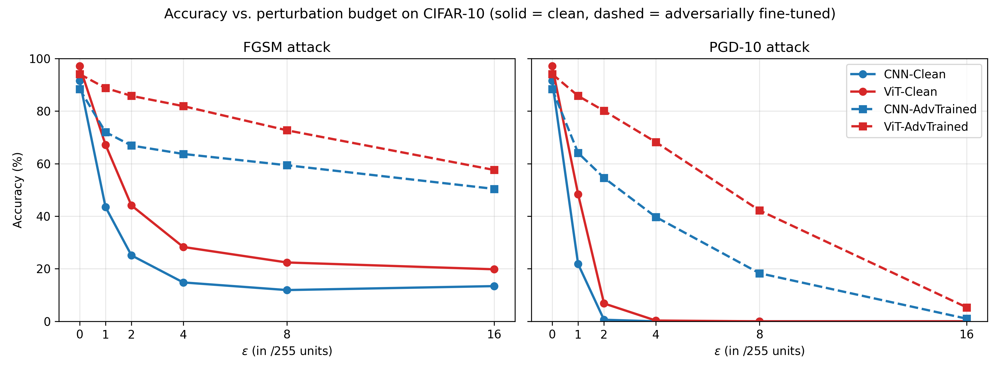
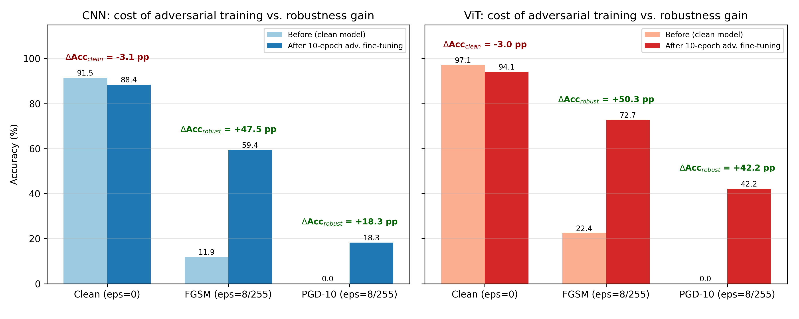
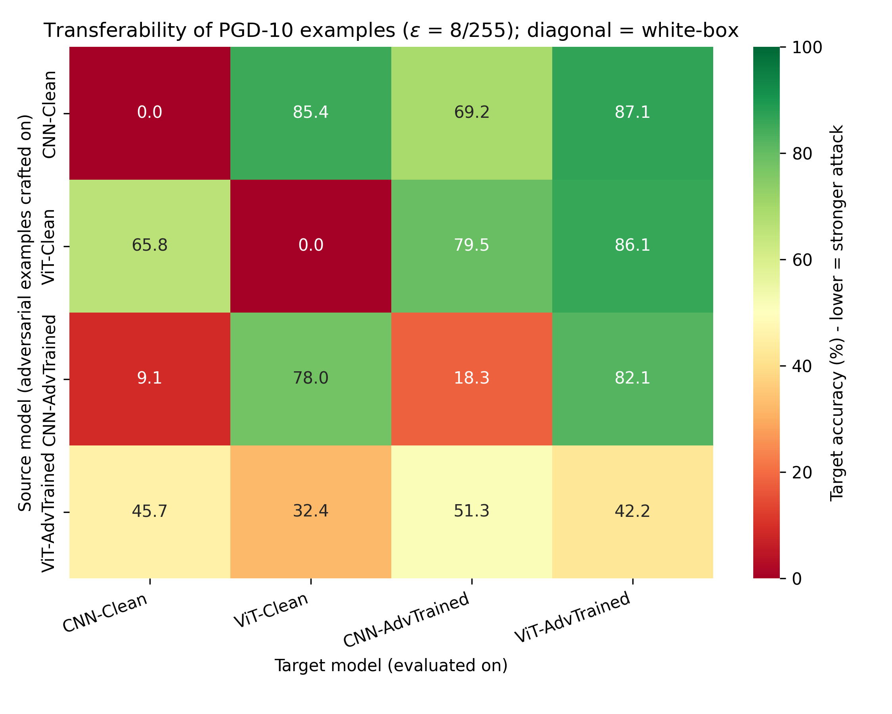
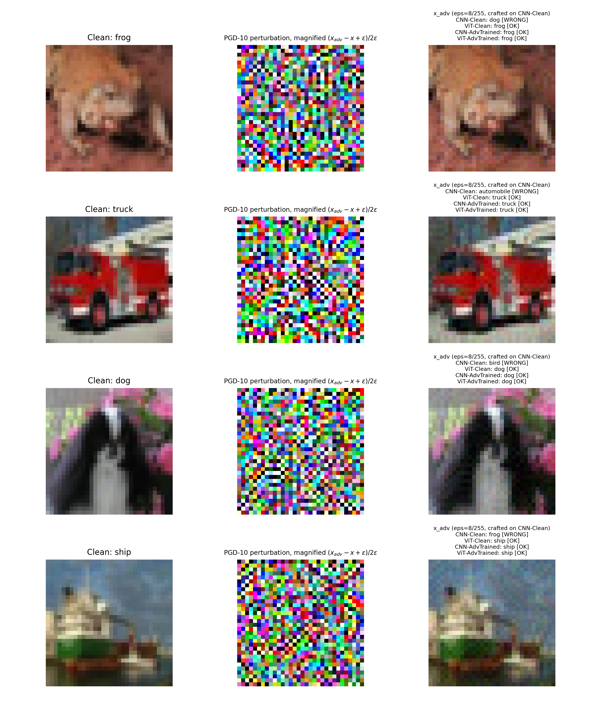

# Adversarial Attacks and Defences: CNN vs Vision Transformer Robustness (CIFAR-10)

Compares how a ResNet-20 (CNN) and a small Vision Transformer hold up against gradient-based L-inf attacks (FGSM, PGD), and measures what adversarial fine-tuning costs in clean accuracy.

Attacks are written from scratch in PyTorch:
- [1] Goodfellow et al., *Explaining and Harnessing Adversarial Examples*, ICLR 2015 (FGSM): https://arxiv.org/abs/1412.6572
- [2] Madry et al., *Towards Deep Learning Models Resistant to Adversarial Attacks*, ICLR 2018 (PGD): https://arxiv.org/abs/1706.06083
- [3] Wong et al., *Fast is better than free*, ICLR 2020 (RS-FGSM): https://arxiv.org/abs/2001.03994

## The four models

| Model | How it is obtained |
| --- | --- |
| `CNN-Clean` | Pretrained CIFAR-10 ResNet-20 (`chenyaofo/pytorch-cifar-models`), no training |
| `ViT-Clean` | timm `vit_tiny_patch16_224` (ImageNet weights), 5-epoch clean fine-tune on CIFAR-10 (default), or `--vit-backbone hf-base` for the pretrained HuggingFace CIFAR-10 ViT-Base |
| `CNN-AdvTrained` | `CNN-Clean` + 10 epochs adversarial fine-tuning (PGD-5, eps = 8/255, AMP) |
| `ViT-AdvTrained` | `ViT-Clean` + 10 epochs adversarial fine-tuning (PGD-5, eps = 8/255, AMP). An earlier RS-FGSM variant is kept in `outputs_vit_rsfgsm/` (see finding 5) |

Training loss: `0.5 * CE(x_clean) + 0.5 * CE(x_adv)`. Images stay in [0, 1] everywhere; mean/std normalisation (and 32 -> 224 bilinear upsampling for the ViT) happens inside `NormalizedModelWrapper.forward()`, so eps and `clamp(0, 1)` are exact in pixel space for both architectures.

## Run on Google Colab / Kaggle (recommended, no local GPU needed)

1. Upload `Adversarial_CNN_vs_ViT_Colab.ipynb` to Colab, choose **Runtime -> Change runtime type -> T4 GPU**.
2. Optional: add a Colab secret `GITHUB_TOKEN` (fine-grained token, Contents read/write on this repo only) to auto-push checkpoints, tables and plots.
3. **Runtime -> Run all.** Checkpoints are saved after every epoch (and to Google Drive when mounted), so a disconnect never forces retraining: rerunning loads existing checkpoints.

## Run locally

```bash
pip install -r requirements.txt
python main.py --quick-test      # CPU smoke test: 64 images, 1 tiny epoch, 2 PGD steps
python main.py --full-run        # needs a GPU: 10-epoch adversarial fine-tuning + full evaluation
python -m src.attacks            # unit assertions: L-inf <= eps and x_adv in [0, 1]
python -m src.models             # output-shape check (4, 3, 32, 32) -> (4, 10)
```

Useful flags: `--epochs 10 --eval-samples 1000 --cnn-method pgd5|rs_fgsm --vit-method pgd5|rs_fgsm --drive-dir PATH --auto-push --force-retrain`. Both methods default to `pgd5`; `--vit-method rs_fgsm` reproduces the faster single-step variant.

## Project layout

```text
Adversarial_CNN_vs_ViT_Colab.ipynb  # generated by scripts/build_notebook.py (embeds src/ and main.py)
main.py                             # CLI
src/{models,attacks,defense,evaluate,visualize,data,utils}.py
scripts/auto_push.sh                # git add / commit / push helper (see TASK.md)
checkpoints/                        # cnn_*.pth, vit_*.pth, training_history.json
outputs/                            # 300-DPI PNGs, results_summary.csv / .md (final run, both models PGD-5)
outputs_vit_rsfgsm/                 # earlier run with ViT-AdvTrained trained by RS-FGSM, kept for comparison
```

Re-run `python scripts/build_notebook.py` after editing anything in `src/` or `main.py`.

## Results

> **Status: full run complete** (Colab T4 GPU, 10-epoch adversarial fine-tuning of both models with PGD-5, N = 1000 test images). Raw numbers: [outputs/results_summary.md](outputs/results_summary.md).

| Deliverable | File |
| --- | --- |
| Accuracy vs. epsilon (FGSM, PGD-10) | [outputs/acc_vs_epsilon.png](outputs/acc_vs_epsilon.png) |
| Cost of adversarial training vs. robustness gain | [outputs/clean_vs_robust_tradeoff.png](outputs/clean_vs_robust_tradeoff.png) |
| Cross-architecture transferability | [outputs/transferability_heatmap.png](outputs/transferability_heatmap.png) |
| Clean / perturbation / adversarial examples | [outputs/adversarial_examples_grid.png](outputs/adversarial_examples_grid.png) |
| Full table | [outputs/results_summary.md](outputs/results_summary.md), [outputs/results_summary.csv](outputs/results_summary.csv) |






### Research findings summary

Accuracy (%) at eps = 8/255, N = 1000 (full table over all eps in `outputs/results_summary.md`):

| Model | Clean | FGSM | PGD-10 |
| --- | --- | --- | --- |
| CNN-Clean (ResNet-20) | 91.5 | 11.9 | 0.0 |
| CNN-AdvTrained (PGD-5) | 88.4 | 59.4 | 18.3 |
| ViT-Clean (ViT-Tiny) | 97.1 | 22.4 | 0.0 |
| ViT-AdvTrained (PGD-5) | 94.1 | 72.7 | 42.2 |

PGD-10 accuracy (%) across eps, the strongest attack evaluated:

| Model | 0 | 1/255 | 2/255 | 4/255 | 8/255 | 16/255 |
| --- | --- | --- | --- | --- | --- | --- |
| CNN-AdvTrained | 88.4 | 64.1 | 54.6 | 39.7 | 18.3 | 1.0 |
| ViT-AdvTrained | 94.1 | 85.8 | 80.1 | 68.2 | 42.2 | 5.3 |

1. **Undefended models collapse under attack, the ViT a little more slowly.** Under PGD-10 the CNN falls to 21.8% at eps = 1/255 and 0.6% at 2/255. The ViT keeps 48.4% at 1/255 and 6.8% at 2/255. Both are at about 0% from 4/255. Under FGSM at 8/255 the ViT keeps 22.4% against 11.9% for the CNN.
2. **Cost of adversarial fine-tuning on clean accuracy.** CNN: 91.5% -> 88.4% (-3.1 points). ViT: 97.1% -> 94.1% (-3.0 points). The two costs are about equal. With N = 1000 the standard error of one accuracy is about 1 point, so the two drops cannot be told apart.
3. **Robustness gained.** Under PGD-10 at 8/255 the CNN goes from 0.0% to 18.3% (+18.3 points) and the ViT from 0.0% to 42.2% (+42.2 points). Under FGSM the gains are +47.5 (CNN) and +50.3 points (ViT).
4. **With the same training recipe, the adversarially trained ViT is more robust than the adversarially trained CNN at every eps.** Both were trained with PGD-5, eps = 8/255, 10 epochs, lr 1e-4. The PGD-10 lead of the ViT is 21.7, 25.5, 28.5, 23.9 and 4.3 points at eps = 1, 2, 4, 8 and 16/255. The lead shrinks at 16/255, twice the training eps, where both models are near 0%. This is a comparison of two specific models, not proof that attention itself causes the difference: ViT-Tiny has about 5.7M parameters, is ImageNet-pretrained and takes 224x224 input, while ResNet-20 has about 0.27M parameters. Model capacity and pretraining are confounded with architecture here.
5. **A single-step training attack was not enough for the ViT.** In an earlier run, `ViT-AdvTrained` was trained with RS-FGSM (results kept in `outputs_vit_rsfgsm/`). It scored 79.8% under FGSM but only 4.9% under PGD-10 at 8/255, and its FGSM accuracy peaked exactly at the training eps. This pattern is typical of catastrophic overfitting in single-step adversarial training (Wong et al., 2020). Switching to PGD-5 raised its PGD-10 accuracy at 8/255 from 4.9% to 42.2% and removed the peak, which is consistent with that explanation. The two runs also differ in that `ViT-Clean` was re-fine-tuned (97.4% -> 97.1%), so this is evidence, not an isolated test. For single-step FGSM numbers, always compare with PGD-10.
6. **Transferability (PGD-10, eps = 8/255; target accuracy, lower = stronger attack).** Cross-architecture transfer from clean sources is much weaker than white-box (0%): examples crafted on CNN-Clean leave ViT-Clean at 85.4%, and examples crafted on ViT-Clean leave CNN-Clean at 65.8%. Adversarially trained targets resist transfer from clean sources: CNN-Clean -> CNN-AdvTrained 69.2%, ViT-Clean -> ViT-AdvTrained 86.1%. Examples crafted on an adversarially trained model transfer best to its own clean starting point: CNN-AdvTrained -> CNN-Clean leaves 9.1%, almost as low as a white-box attack, and ViT-AdvTrained -> ViT-Clean leaves 32.4%. Transfer attacks overstate the robustness of `ViT-AdvTrained`: other models' examples leave it at 82 to 87%, but a white-box attack leaves it at 42.2%.

Training cost on the Colab T4: CNN 6.3 min (PGD-5), ViT 74.7 min (PGD-5), summed from the per-epoch times in `checkpoints/training_history.json`. In the earlier RS-FGSM run the ViT took 30.1 min. PGD-5 is therefore about 2.5x slower for the ViT. The final ViT run took 111 min in total (`outputs/run_info.json`). That total includes a slow 22-minute CIFAR-10 download and the 5-epoch clean ViT fine-tune, and the CNN was not retrained in that run.

## Evaluation protocol and caveats

- Evaluation uses a fixed stratified subset of N = 1000 CIFAR-10 test images (100 per class, seed 42). With N = 1000 the standard error of an accuracy is up to about 1.6 points, so small differences are not significant.
- PGD-10 uses alpha = max(eps/4, 1/255) with a random start. This is a white-box evaluation with a modest number of steps; it is an upper bound on robustness, not a certified one. Stronger attacks (more steps, restarts, AutoAttack) would lower the numbers.
- Training-time numbers come from a single run with seed 42; no repeat runs, so no variance estimate across training seeds.
- The final results come from two Colab sessions. `CNN-Clean` and `CNN-AdvTrained` come from the first session; `ViT-Clean` and `ViT-AdvTrained` come from the second, which re-ran the 5-epoch clean ViT fine-tune because `vit_clean.pth` had not been saved. `CNN-Clean` is the same pretrained checkpoint in both sessions, and `cnn_adv.pth` is unchanged.
- Large single weight files (> 95 MB, e.g. ViT-Base) are excluded from git automatically; keep them on Google Drive.
